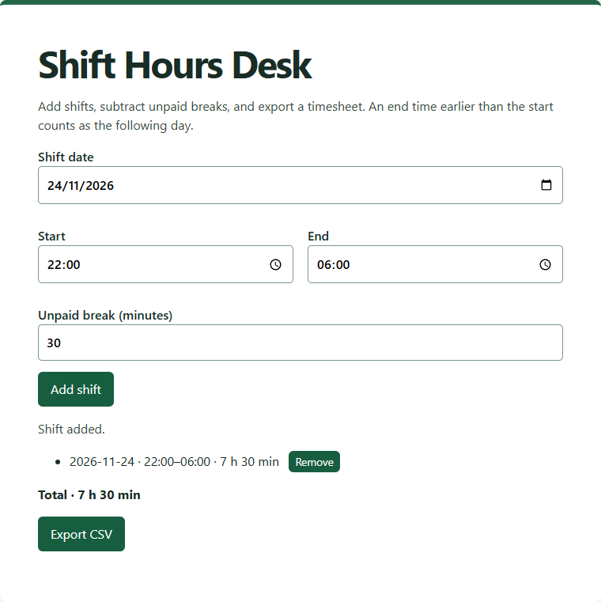

# Shift Hours Desk

Add shifts, subtract unpaid breaks, and export a timesheet. An end time earlier than the start counts as the following day.

Download `index.html` and open it in your browser. It works offline with no account or installation. Data stays in the open tab. Export or print before closing the tab.

## Example

A shift from 22:00 to 06:00 with a 30-minute break contributes 7 h 30 min. Durations use wall-clock time; daylight-saving changes are not applied.
